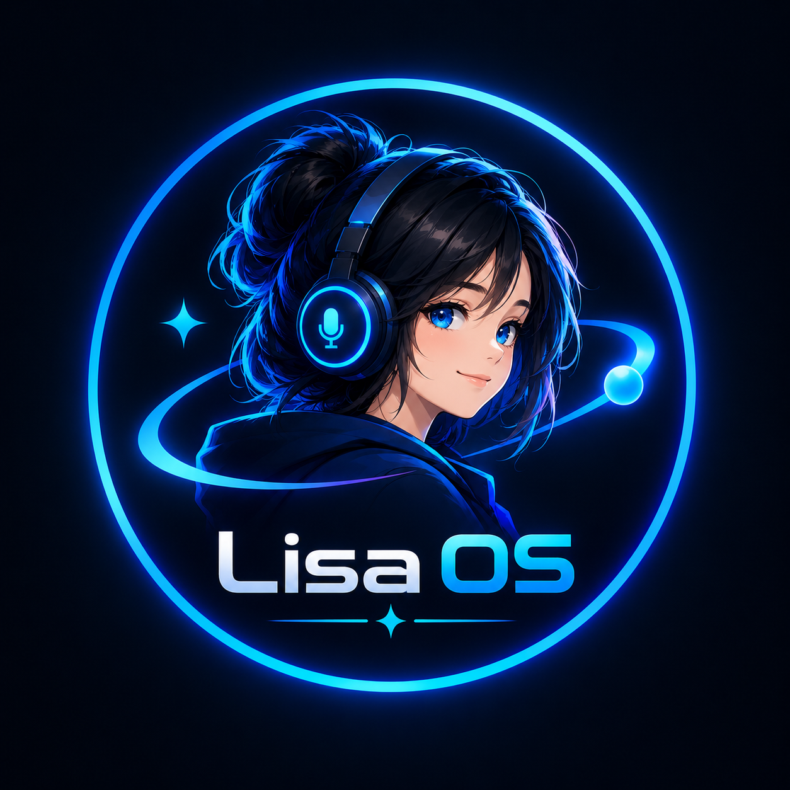

# Lisa AI - Autonomous Desktop Operating Intelligence

<div align="center">



### The Self-Evolving, Multimodal Personal AI Desktop Environment

[](https://python.org)
[](https://riverbankcomputing.com/software/pyqt/)
[](https://ai.google.dev/)
[](https://modelcontextprotocol.io/)
[](https://microsoft.com/windows)

</div>

---

## Overview

**Lisa AI** is a next-generation desktop intelligence built to function like an authentic JARVIS workstation. Combining real-time bi-directional native voice audio, multimodal computer vision, autonomous code self-evolution, and local system orchestration, Lisa AI transforms your Windows PC into a self-evolving command center.

---

## What's New

### Particle Orb + HUD Orb UIs
Lisa AI ships with two reactive orb interfaces driven by a shared state bridge (`orb_bridge.py`):

- **Main Particle Orb** (`orb_stage.py`) - Embedded particle-sphere visualizer shown in the app window. Idle = gentle breathing, Listening = dots react to your live microphone, Speaking = dots jump with your TTS audio.
- **External HUD Orb** (`hud_overlay.py`) - A transparent, always-on-top, draggable native overlay. It stays on screen even when the main app is minimized, so you can talk to Lisa while working in other apps.

### Holographic Hardware Assembler & Circuit HUD
- Screen and voice part recognition for microcontrollers, sensors, and passives.
- In-app glassmorphic popup with pinout labels, animated neon SVG wires, and ready-to-flash firmware.

### Project Ultron - Self-Evolving Skill Crucible
- On-the-fly Python tool synthesis, sandbox testing, and hot-reload without restarting.

### Proactive Auto-Heal Engine
- Background sentry catches runtime exceptions, reasons about the root cause, and applies safe patches.

### Real-Time FFT Audio Waveform & Dynamic Glow Core
- Live frequency spectrum in the Command Bar with state-driven glow colors.

### Visual Chain-of-Thought Execution Tracker
- Collapsible, step-by-step execution traces embedded in chat bubbles.

### Interactive 3D HoloGlobe & Geospatial Radar
- WebGL Earth with live flight routes, radar tracking, driving routes, and nearby POI scans.

---

## Installation

### 1. Clone the repository

```bash
git clone https://github.com/RoyExploit/Lisa-Ai.git
cd Lisa-Ai
```

### 2. Create and activate a virtual environment

```bash
python -m venv .venv
.venv\Scripts\activate
```

### 3. Install dependencies

```bash
pip install -r requirements.txt
```

> **Note:** `pyaudio` requires the Microsoft C++ Build Tools. If it fails to build, you can skip it - the app uses `sounddevice` for audio capture and playback.

### 4. Install Playwright browsers (for web automation)

```bash
python -m playwright install
```

### 5. Configure your API keys

Copy `config/api_keys.example.json` to `config/api_keys.json` and fill in your keys (Google Gemini, etc.).

### 6. Launch

```bash
python main.py
```

Or double-click `start_lisa.bat` (or `start_lisa.vbs` to run silently in the background).

---

## Running the Orb UIs

### Main Particle Orb
The main orb launches automatically with the app. To disable it, set the environment variable `LISA_MAIN_ORB=0`.

### External HUD Orb
The HUD is a **native PyQt6 transparent overlay** (`hud_overlay.py`) that runs
inside the Lisa AI process. It is always on top, draggable, and stays on
screen even when the main window is minimized, so you can talk to Lisa while
working in other apps.

No NPM, no Electron, no localhost server, and no second process are involved,
so it bundles into the single release EXE and works fully offline.

To disable the HUD integration, set `LISA_HUD_ORB=0`. To disable both orbs, set `LISA_ORBS=0`.

---

## Building the Offline Installer (EXE)

The distributable `LisaAI_Setup.exe` is a single self-contained file that
installs Lisa AI on any Windows 10/11 PC with **all dependencies bundled** -
the target machine needs no Python, no pip, no setup. Installation works
fully offline.

**If the EXE is ever lost, always recreate it from the source code with two
commands** (run inside the project folder):

```powershell
# Step 1 - build the app folder (creates dist\LisaAI\ with LisaAI.exe)
.venv\Scripts\pyinstaller.exe --noconfirm installer\LisaAI.spec

# Step 2 - pack that folder into the single-file installer
.venv\Scripts\pyinstaller.exe --noconfirm installer\LisaAI_Setup.spec
```

The installer then appears at **`dist\LisaAI_Setup.exe`** - copy that one
file to any PC and run it. The wizard unpacks everything and creates Desktop
and Start-menu "Lisa AI" shortcuts.

Notes:
- One-time build setup: `.venv\Scripts\python.exe -m pip install -r requirements.txt pyinstaller pywin32`
- **Order matters** - Step 2 packs whatever Step 1 produced, so always run both.
- Personal data (API keys, identity, memory, settings) is automatically
  excluded from the installer.
- Full packaging details: `installer/README.md`.

---

## Voice & Command Cheat Sheet

| Intent | Sample Voice / Text Command |
| :--- | :--- |
| Hardware Circuit | "Lisa, how to connect DHT11 to Arduino Pro Mini" |
| Circuit Vision | "See the Arduino parts on my screen and tell me how to assemble them" |
| Self-Evolution | "Lisa, learn a new skill to track International Space Station coordinates" |
| Flight Radar | "Show flight route from Mumbai to London" |
| Nearby Amenities | "Find nearby hospitals on the map" |
| Music Playback | "Play Starboy on Spotify" |
| Phone Screening | "Screen this incoming call for me" |
| Office Documents | "Create a project roadmap spreadsheet in Excel" |
| System Health | "Check system resources and kill heavy apps" |

---

## Architecture

```
Lisa AI/
|-- main.py                  # Main entry point and live event loop
|-- ui.py                    # PyQt6 GUI: Command Bar, FFT waveform, HUD wings, chat
|-- orb_bridge.py            # Drives the particle orb + external HUD orb from app state
|-- orb_stage.py             # Embedded particle-orb UI (native, in-app)
|-- hud_overlay.py           # Native HUD orb: transparent, always-on-top overlay (PyQt6)
|-- llm_client.py            # LLM provider client (Gemini, etc.)
|-- or_client.py             # OpenRouter client
|-- discord_bot.py           # Discord integration
|-- sound_manager.py         # Sound effects and audio cues
|-- actions/                 # Built-in action tools and executors
|   |-- circuit_assembler.py # Hardware vision and circuit solver
|   |-- spotify_controller.py# Spotify playback control
|   |-- geospatial_globe.py  # Routes, radar, and POI fetcher
|   |-- auto_heal_engine.py  # Exception interceptor and patcher
|   |-- call_assistant.py    # Phone call proxy and transcript analyzer
|   |-- office_builder.py    # Excel, Word, PPTX, and PDF generators
|-- core/                    # Core system architecture
|   |-- circuit_hud.py       # In-app holographic circuit overlay
|   |-- globe_window.py      # 3D WebGL Earth and map controller
|   |-- skill_forge.py       # LLM skill synthesizer (Project Ultron)
|   |-- skill_crucible.py    # Isolated test execution sandbox
|   |-- dynamic_registry.py  # Runtime tool hot-reloader
|   |-- identity.py          # System prompt and behavioral core
|-- agent/                   # Planning and execution agents
|-- features/                # Self-evolved and custom Python tools
|-- lisa_connect/            # Companion device gateway and pairing
|-- smart_home/              # Smart device providers and discovery
|-- dashboard/               # Mobile/web dashboard server
|-- memory/                  # Memory and session persistence
|-- config/                  # Configuration and identity
|-- installer/               # PyInstaller specs and install wizard
|-- assets/                  # Logos, icons, sounds, and backgrounds
|-- tests/                   # Test suite
```

---

## Security & Privacy

- All long-term memories, credentials, and configuration files are stored locally in `%LOCALAPPDATA%\LisaAI\`.
- External tools run through permission sentries and the isolated Crucible sandbox.
- Audio and video frames are only streamed during active conversation sessions.

---

## License

**Personal & Private Local Use Only - No Distribution.**

This project is licensed under the **Lisa AI Source-Available Personal Use License**.

- **Allowed:** You may download, clone, inspect, build, and run the software locally strictly on your own personal device for private, educational, and research use.
- **Prohibited (No Distribution):** You may NOT distribute, redistribute, re-upload, mirror, share, transmit, sublicense, or publish this software, repository, binaries, or derivative works anywhere.
- **Prohibited (No Commercial Use):** You may NOT sell, rent, monetize, bundle, commercialize, or host this software as a paid SaaS or cloud service.

For full terms and legal conditions, see the [LICENSE](LICENSE) file.

---

<div align="center">
<b>Lisa AI</b> - Built with intelligence, precision, and autonomy.
</div>
